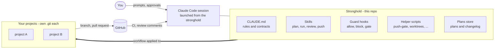
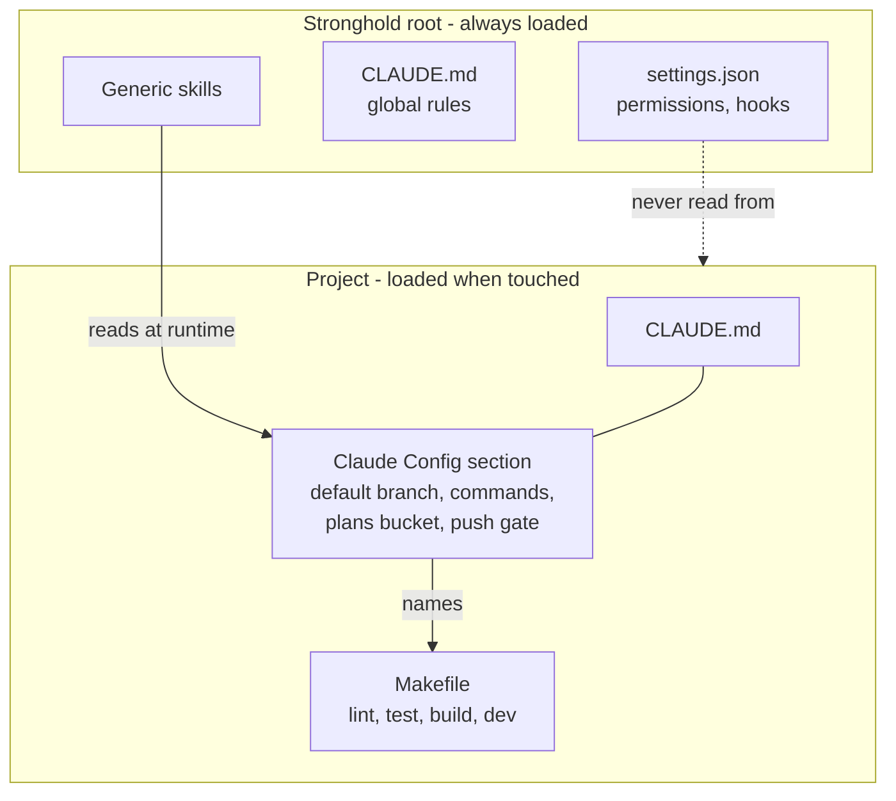
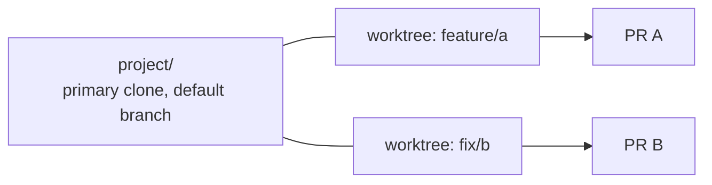
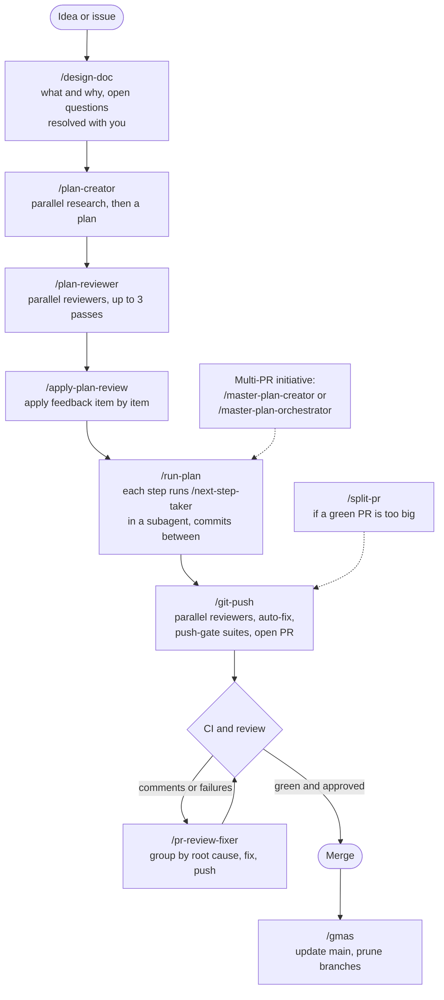
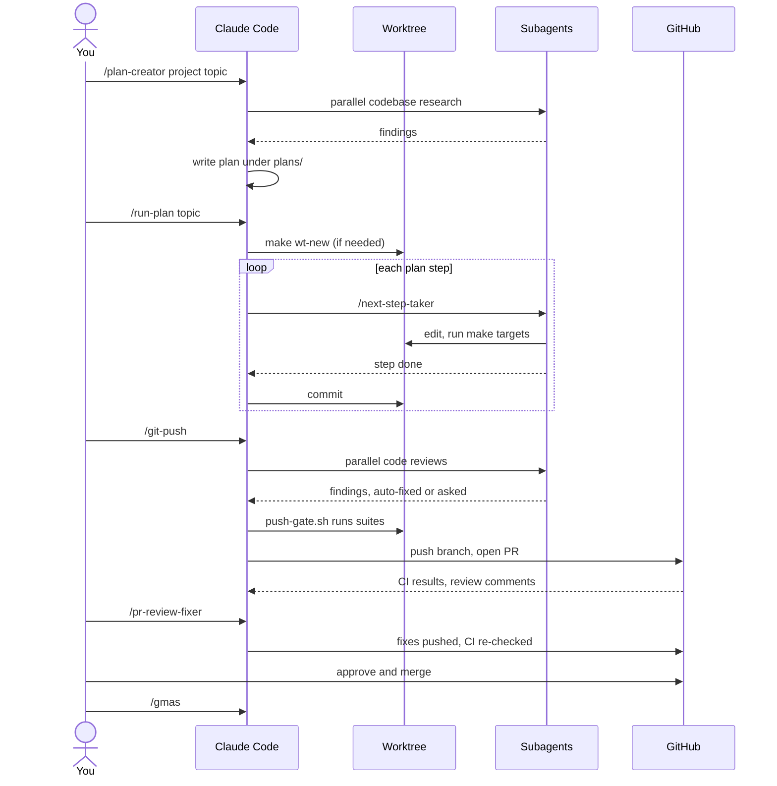
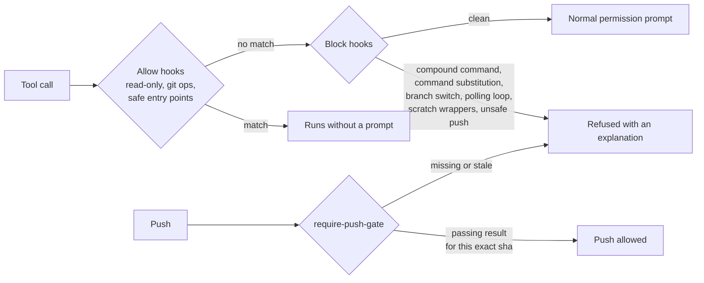
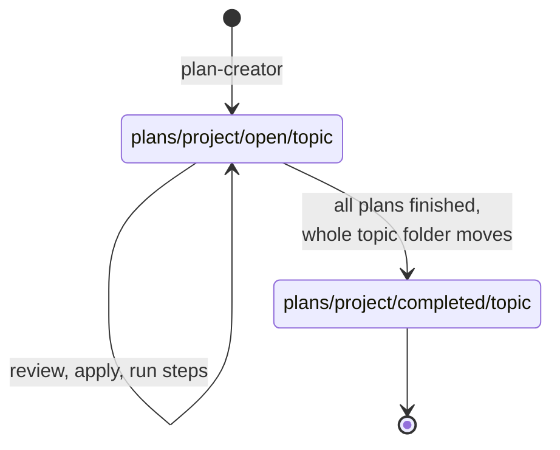
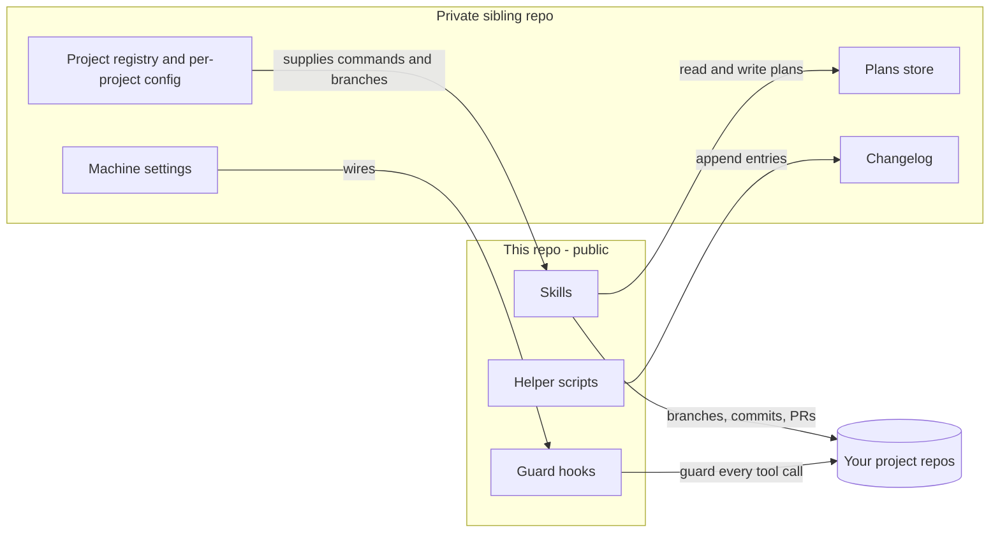

# Stronghold

A reusable workflow layer for [Claude Code](https://claude.com/claude-code): skills, guard hooks and helper
scripts that sit above all of your project repos, plus a convention for keeping plans, reviews and a
changelog in one place.

You launch Claude Code from this directory, never from inside a project. That makes this repo the control
plane: its settings, hooks and skills are the only ones that load, so every project gets the same workflow
and the same safety rails.

> This repository is a **sanitized mirror**. It contains the reusable half of a working setup. The half
> that holds state is private. See [What stays private](#what-stays-private).

- [What it is](#what-it-is)
- [How it sits over your projects](#how-it-sits-over-your-projects)
- [Day-to-day usage](#day-to-day-usage)
- [Guardrails](#guardrails)
- [The plans store](#the-plans-store)
- [What stays private](#what-stays-private)
- [Getting started](#getting-started)

---

## What it is



| The stronghold owns | Each project owns |
|---|---|
| Workflow skills, hooks, scripts | Application source, tests, CI |
| Plans, reviews, research, mocks | Its own `Makefile` and `CLAUDE.md` |
| A changelog of what Claude did | Stack-specific helper skills |
| Permission and sandbox policy | A `## Claude Config` section that generic skills read |

---

## How it sits over your projects

```
<stronghold>/
|-- CLAUDE.md                <- rules, loaded every session
|-- Makefile                 <- workflow entry points
|-- .claude/
|   |-- settings.json        <- permissions + hook wiring (the only one that loads)
|   |-- hooks/               <- guard hooks
|   |-- scripts/             <- durable entry points
|   `-- skills/              <- generic skills
|-- plans/<project>/{open,completed}/<topic>/
|-- changelog/  misc/  knowledge/
`-- <project>/               <- gitignored here, its own .git and CLAUDE.md
```

Claude Code only reads `settings.json` from the launch root, so a nested project cannot override policy.
Skills and `CLAUDE.md` files load on demand once a project's files are touched.



The `## Claude Config` section is the contract between generic workflow and project specifics. A skill
such as `git-push` never hardcodes a test command; it reads the project's declared `Push gate` and
`Commands`. Adding a project means giving it a `Makefile` and a config section.

### Worktrees

One worktree per branch, with the primary clone left on the default branch. `make wt-new REPO=<repo>
BRANCH=<branch>` is the only creation path. Delegated subagents verify their branch and stop on a mismatch
instead of switching.



---

## Day-to-day usage

Each box is a skill, run from the stronghold with the project and plan named as the argument. Heavy work is
delegated to subagents so the main context stays small.





### Skill map

| Phase | Skills |
|---|---|
| Define | `design-doc` |
| Plan | `plan-creator`, `master-plan-creator`, `master-plan-orchestrator`, `plan-list` |
| Review a plan | `plan-reviewer`, `apply-plan-review` |
| Execute | `run-plan`, `next-step-taker`, `run-review` |
| Ship | `git-commit`, `git-push`, `split-pr` |
| After the PR | `pr-review`, `pr-review-fixer`, `gmas` |
| Utilities | `git-changes-summary`, `test-failure-logger`, `format-table`, `skill-creator` |

---

## Guardrails

Hooks run before every tool call so automation can be fast without being able to do something
irreversible by accident.



- **Fail closed.** Permission and validity flags default to the denying value.
- **Push gate.** A push is refused unless `push-gate.sh` recorded a passing run for the exact commit being
  pushed. The suites come from the project's config section, never guessed.
- **Secrets.** Account-specific IDs live only in the owning project's `CLAUDE.md`. Anything that could be
  a credential gets a question before it is committed.
- **Worktree discipline.** Subagents assert their branch and stop on a mismatch.

---

## The plans store

All plans, research, reviews and mocks live in one tree here, never inside the projects.



`.claude/scripts/plan-list.sh [<project>]` shows what is open across everything.

---

## What stays private

This repo is half of a working system. The other half is a **private sibling repo** that holds the state
the workflow operates on. Skills here read from it and write to it, so some commands assume it exists.
You build your own as you use the skills; the folders `plans/`, `changelog/`, `misc/` and `knowledge/` in
this repo are empty on purpose, ready to be filled.

| Category | What it is | How the public skills use it |
|---|---|---|
| Plans store | Plans, research, reviews and design mocks for every project, organized by project and topic | `plan-creator`, `plan-reviewer`, `run-plan` and the rest read and write it |
| Changelog | A dated log of what the automation did | `changelog-add.sh` appends to it |
| Host and network records | Notes on the machines and network the projects run on | Never used by a skill; a reference for the owner when changing infrastructure |
| Runbooks and dotfiles | Operational procedures and machine configuration | Never used by a skill |
| Machine settings | Permission policy, sandbox paths and tool wiring for one machine | The hooks only work once this wiring exists; `settings.example.json` shows the shape |
| Project registry and credentials setup | The list of project repos, per-project config, bot and token setup | Skills read a per-project config block at runtime; its keys are documented in `CLAUDE.md` |



### Using this without the private half

You only need the minimum, and the template gives you most of it:

1. Create the plans layout (`plans/<project>/open` and `completed`): the empty folders are here.
2. Keep a `changelog/` directory: also here.
3. Copy `settings.example.json` to `.claude/settings.json` and add your own permission rules.
4. Add a `## Claude Config` block to each project's `CLAUDE.md` using the keys documented in `CLAUDE.md`.

---

## Getting started

See [`SETUP.md`](SETUP.md). In short: copy the example settings, replace the `OWNER/stronghold`
placeholders with your repo, clone your projects next to the stronghold, give each a `Makefile` and a
config block, then launch Claude Code from this directory and try `/design-doc` or `/plan-creator`.

`make help` lists the workflow targets.
